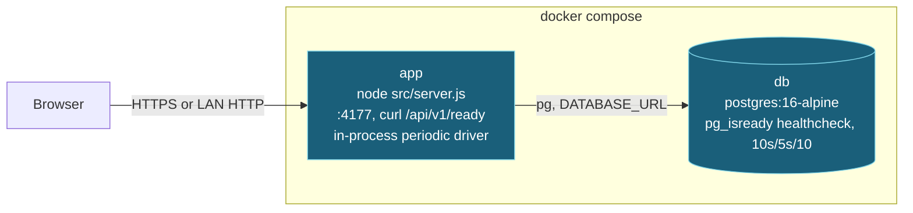
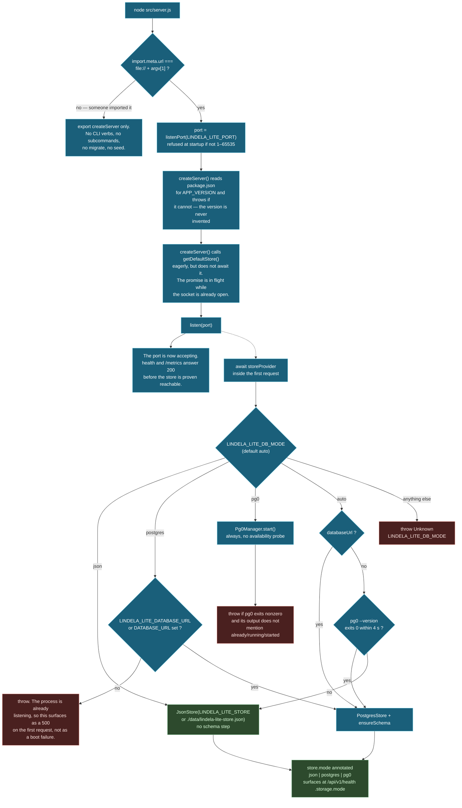
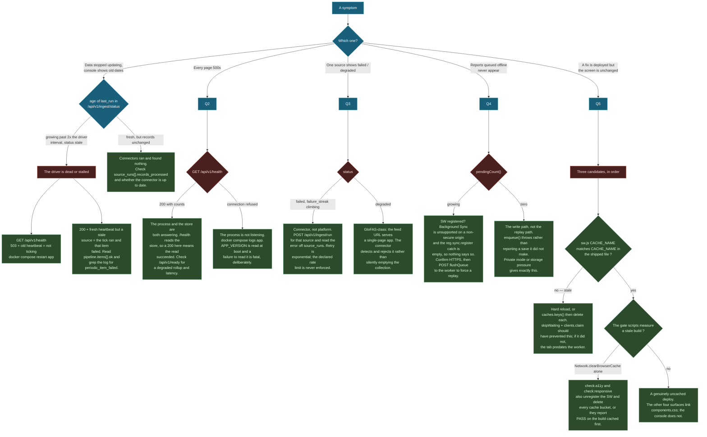

# Deployment

Topology, configuration, and — more than half of this document — what to do when it
is down. Lindela Lite is three containers and no orchestrator, so most of the
operational surface is knowing which of the three stopped and what its absence
looks like from the other two.

Read [system-overview.md](system-overview.md) §3 for the topology in one picture,
and §6–§7 for the boundary failures and the deliberate limitations.

---

## 1. The single most important operational fact

**If the periodic driver stops ticking, ingestion stops, and `/api/v1/health`
says so within one interval.**

The driver is a `setInterval` inside the server process
(`createPeriodicDriver`, `src/server.js:443`), started from the listen callback
(`src/server.js:1815`). It runs ingestion schedules, alert evaluation, outbox
dispatch, retention and report schedules, and writes one `system_heartbeat` row
per tick recording every item and whether it succeeded
(`runPeriodicTick`, `src/server.js:320`). `/api/v1/health` returns 503 when that
heartbeat is older than the interval, so a pipeline that has stopped running
says so rather than looking idle.

`docker-compose.yml` runs two services, `db` and `app`. An external shell loop
that called `run-due` from a third container is gone — see ADR-009, whose
**Decision** section is superseded while its reasoning about locks and
crash loops still applies.

**How to detect it.** `GET /api/v1/health` first — it answers the liveness
question directly:

- **`503` with a heartbeat age past the interval** — the driver is not ticking.
  The tick is guarded by an `inFlight` flag, so a hung item stalls the loop
  rather than stacking; the heartbeat stops and the check fires.
- **`pipeline.items[].ok: false`** — an individual item failed. The tick
  continues with the rest by design, and the failing item is logged as
  `periodic_item_failed` with its message and stack.

Per source, `GET /api/v1/ingest/status`:

- **`age(last_run.completed_at)`** — if it exceeds the driver interval by more
  than one cycle while the heartbeat is current, the driver is ticking and the
  schedule is not due: check `next_run_at` and `status`, not liveness.
- **`status: 'stale'`** — computed by `sourceHealth` against
  `schedule.stale_after_minutes ?? policy.stale_after_minutes`.
- **`failure_streak: 0` does not mean healthy.** `failureStreak` counts
  consecutive `source_runs` rows with `status === 'failed'`. **A driver that
  never runs produces no rows at all**, so the streak stays at whatever it was —
  usually zero. A rising streak means the connectors are failing. A zero streak
  with a growing `last_run` age means nothing is running. Reading the streak alone
  is how a stopped pipeline looks like a healthy one.

**How to fix it.**

```bash
curl -fsS http://127.0.0.1:4177/api/v1/health          # heartbeat age, item verdicts
docker compose logs -f app | grep periodic_item_failed
docker compose restart app                             # the driver lives in this process
curl -fsS -X POST http://127.0.0.1:4177/api/v1/ingest/run-due \
  -H "x-api-key: $LINDELA_LITE_API_KEY"   # force one cycle by hand
```

A `401` on that manual call means the key is wrong. The driver does not use one
— it calls `runDueIngestionSchedules` in-process — so a bad key breaks manual and
external callers only, which is a strictly smaller failure than the sidecar's
silent `|| true` loop was.

## 2. Topology



The driver is a timer in `app`, so `app` dying and the driver dying are the same
event: compose restarts the container and the timer comes back with it. What
compose still cannot see is the *item* level — a tick whose ingestion item throws
records `ok: false` on the heartbeat and keeps going, so the container is healthy
while a source is not. That is what `/api/v1/health` is for, and why it is the
first command in the fix-it block above.

## 3. Startup



**There is no subcommand parsing.** The bottom of `src/server.js` is four lines:

```js
if (import.meta.url === `file://${process.argv[1]}`) {
  const port = Number(process.env.LINDELA_LITE_PORT || 4177)
  createServer().listen(port, () => { /* … */ })
}
```

`node src/server.js --migrate` passes `--migrate` to nothing and starts normally.
Schema setup is `ensureSchema()` inside store construction; seeding is
`npm run demo:seed`; validation is `npm run validate`. A CLI that grew verbs would
be a different architecture.

**`createServer(options)`** takes an optional `store`, which is how
`test/*.test.js` runs the whole HTTP surface against a fixture store with no
database and no environment.

### Store selection

`createStoreFromEnv` in `src/storage.js`, in precedence order:

| `LINDELA_LITE_DB_MODE` | Behaviour |
|---|---|
| `json` | `JsonStore(LINDELA_LITE_STORE \|\| ./data/lindela-lite-store.json)`. No schema step. |
| `postgres` | Requires `LINDELA_LITE_DATABASE_URL` or `DATABASE_URL`; **throws** without one. |
| `pg0` | `Pg0Manager.start()` unconditionally — no availability probe. |
| `auto` *(default)* | `databaseUrl` → postgres. Else `pg0 --version` exits 0 within 4 s → pg0. Else JSON. |
| anything else | Throws `Unknown LINDELA_LITE_DB_MODE`. |

`auto` is the mode that matters in the field. In the compose `app` service it is
overridden to `postgres` explicitly, so the fallback chain never runs there. Run
from a laptop with no Postgres and no `pg0` binary, it lands on JSON, and **the
choice is invisible until you look at `/api/v1/health`**, which reports
`storage: { mode }`. `docker compose logs app` says only "listening on".

`postgres` and `pg0` both call `ensureSchema()` — one `CREATE TABLE IF NOT EXISTS`
and the vocabularies in `schema.js`. It is idempotent and runs on every boot.

### Ordering, and what it means for readiness

`getDefaultStore()` is called eagerly inside `createServer`, which *starts* the
async store construction. It is **not awaited** before `listen`. Consequences:

- The port is accepting before the store is proven reachable. `/metrics` answers
  `200` while the database is still down; `/api/v1/ready` is the probe that
  reports it.
- A store construction failure (missing `DATABASE_URL`, pg0 refusing to start, an
  unreachable host) surfaces as a rejected promise awaited inside the request
  handler, i.e. a **500 on the first request that needs the store**, not a boot
  failure. The container stays up. Compose's healthcheck curls `/api/v1/ready`,
  which answers **503** in exactly this state — that is the fix for R-33, below.
- `APP_VERSION` is read once at startup and a failure to read `package.json` **is**
  fatal. That asymmetry is deliberate: an unknown version must not be invented, but
  an unreachable database is a runtime condition the app can report on.

**This is why `/api/v1/ready` exists** and why `/api/v1/health` alone is not a
readiness signal. See §7.

**R-33 — the probe used to be the load generator.** Both healthchecks curled
`/api/v1/health`, and `/api/v1/health` reads the store: it reports `counts` and
the pipeline verdict, so `collectionsForRequest` returns `null` for it — a
whole-store read, 38 of the 65 collections and 97.8% of the bytes. On a 30-second
clock that made the most-frequent request in the deployment, one whose answer no
person reads, walk nearly every row forever. Both probes now curl
`/api/v1/ready`: one scoped read of the two collections its rollups need, behind
a 2000 ms timeout, answering `503` rather than `500` when the store cannot be
read. `test/deployment-probe.test.js` reads the two deployment files and fails if
any probe they carry asks for a route that materialises the whole store.

## 4. Configuration

Every environment variable the runtime reads, grouped by who sets it.

### Set by the operator (deployment)

| Variable | Default | Notes |
|---|---|---|
| `LINDELA_LITE_PORT` | `4177` | Read by the CLI at the bottom of `server.js`, and by `Dockerfile`'s `HEALTHCHECK`. Compose maps `${LINDELA_LITE_PORT:-4177}:4177`. |
| `LINDELA_LITE_DB_MODE` | `auto` | `json` \| `postgres` \| `pg0` \| `auto`. Compose sets `postgres`. |
| `LINDELA_LITE_DATABASE_URL` | — | Falls back to `DATABASE_URL`. Required when mode is `postgres`. |
| `DATABASE_URL` | — | Fallback only. |
| `LINDELA_LITE_STORE` | `./data/lindela-lite-store.json` | JSON store file path. |
| `LINDELA_LITE_API_KEY` | — | **Sets auth to a single `*`-scoped token.** See §6. |
| `LINDELA_LITE_TOKENS` | — | JSON array of `{token, scopes, partner_org?}`. Malformed throws. |
| `LINDELA_LITE_PUBLIC_PATHS` | — | Comma-separated, widens the public list. |
| `LINDELA_LITE_LOG_LEVEL` | `info` | `debug` \| `info` \| `warn` \| `error`, case-insensitive. Anything else is refused at startup: an unknown name used to compare as `undefined`, which suppressed nothing. |
| `LINDELA_LITE_MAX_BODY_BYTES` | — | Request body cap. |
| `LINDELA_LITE_SCHEDULER_INTERVAL_SECONDS` | `900` | Driver interval, read by `driverIntervalSeconds` (`src/server.js:409`) and used as the `/api/v1/health` staleness threshold. A value that is not a positive number falls back to 900. |
| `LINDELA_LITE_UPTIME_OVERRIDE` | — | Pins the reported uptime. For load-balancer warm-up. |
| `NODE_ENV` | — | Set to `production` in the `Dockerfile`. |

### Set by the platform (pg0 — development only)

`PG0_BIN`, `PG0_NAME` / `LINDELA_LITE_PG0_NAME`, `PG0_PORT` /
`LINDELA_LITE_PG0_PORT`, `PG0_DATA_DIR` / `LINDELA_LITE_PG0_DATA_DIR`.
`Pg0Manager.available()` shells `pg0 --version` with a 4 s timeout. **There is no
`pg0` binary in the image** — `Dockerfile` installs `ca-certificates` and `curl`
only — so a container left in `auto` with no `DATABASE_URL` silently falls back to
a JSON store on an ephemeral filesystem.

### Set by the operator (data sources)

| Variable | Notes |
|---|---|
| `NASA_FIRMS_MAP_KEY` | Defaults to `OPEN_KEY` in `.env.example`. |

Full per-connector configuration — the CHIRPS, GloFAS, GDACS, USGS, NOAA, IPC/HDX
and WHO GHO endpoints and their polling intervals — is in `src/connectors/*` and
`src/ingestion.js`, not in the environment. See [ingestion.md](ingestion.md).

### Set by the operator (RapidPro)

| Variable | Default | Notes |
|---|---|---|
| `RAPIDPRO_BASE_URL` | `https://rapidpro.io` | |
| `RAPIDPRO_API_TOKEN` | — | Outbound SMS. |
| `RAPIDPRO_ALERT_MODE` | `flow_start` | Or `broadcast`. |
| `RAPIDPRO_ALERT_FLOW_UUID` | — | |
| `RAPIDPRO_ALERT_URNS` / `_CONTACTS` / `_GROUPS` | — | Comma-separated. |
| `RAPIDPRO_BASE_LANGUAGE` | `eng` | |
| `RAPIDPRO_WEBHOOK_SECRET` | — | HMAC key for the inbound webhook. See §6. |
| `LINDELA_LITE_RAPIDPRO_INSECURE_ALLOW_UNSIGNED` | — | Must be `1` to accept unsigned inbound webhooks. |
| `LINDELA_LITE_DHIS` | — | DHIS2 bidirectional sync, which is a scaffold. |

### Set by the operator (governance)

| Variable | Notes |
|---|---|
| `LINDELA_LITE_PII_SALT` | Key for `pii.js`. |
| `LINDELA_LITE_PII_POLICY` | Redaction policy. |
| `LINDELA_LITE_REPORT_SIGNING_KEY` | HMAC key for the KPI report footer (`src/pdf.js`). Unset, the footer prints an unkeyed content digest and says so. |
| `LINDELA_LITE_REPORT_SIGNING_KEY_ID` | Printed beside the keyed digest, so a recipient knows which key to verify with. |
| `OFAC_SDN_CACHE_TTL_MS` | Sanctions list cache lifetime. |

Note `redactPii` is implemented and tested but **never called from a request path** —
see [system-overview.md](system-overview.md) §7.

## 5. Container and compose

### `Dockerfile`

```
FROM node:20-bookworm-slim
```

`npm ci --omit=dev` — so the runtime dependency surface is exactly `pg` and
whatever its tree. `ca-certificates` and `curl` are installed explicitly; `curl` is
for the `HEALTHCHECK`. Note `openssl` is *not* installed, which is why
`deploy/one-click.sh` has a `node -e "…randomBytes(24)…"` fallback — the Node
binary it would otherwise fall back on is the one already in the image.

```
HEALTHCHECK --interval=30s --timeout=5s --start-period=20s --retries=5 \
  CMD curl -fsS "http://127.0.0.1:${LINDELA_LITE_PORT}/api/v1/ready" >/dev/null || exit 1
EXPOSE 4177
CMD ["npm", "start"]
```

**The container runs as root.** There is no `USER` directive and no `node` user.
Anyone who can write to the mounted filesystem, or exploit the Node process, is
root in that container. Adding `USER node` requires chowning `data/` first, because
the JSON store and pg0's data directory are both written at runtime. Recorded as a
risk in §8, not as a defect.

`src`, `public`, `docs`, `examples`, `scripts`, `README.md` and `LICENSE` are
copied in. `test/` is not, and `node_modules` contains dev dependencies only
because `npm ci --omit=dev` runs before the source copy.

### `docker-compose.yml`

Three services, all `restart: unless-stopped`.

- **`db`** — `postgres:16-alpine`, volume `lindela_lite_pgdata`. Healthcheck
  `pg_isready -U $POSTGRES_USER -d $POSTGRES_DB`, 10 s interval, 5 s timeout, 10
  retries. `POSTGRES_PASSWORD` is written into `.env` by `one-click.sh`, never into
  `docker-compose.yml`; `.env.example` ships the literal `change-me`, so a
  deployment that copies it by hand runs on a password in a tracked file.
- **`app`** — `depends_on: db: condition: service_healthy`, so Postgres finishes
  initialising before the first connection attempt. Maps
  `${LINDELA_LITE_PORT:-4177}:4177`. Its own `HEALTHCHECK` curl and one in the
  `Dockerfile` are near-duplicates; the compose one wins, and hardcodes `4177`
  rather than the port variable, so changing `LINDELA_LITE_PORT` breaks it.
- **`scheduler`** — **removed.** `docker-compose.yml` declares `db` and `app` and
  nothing else. The shell loop above was retired when the in-process driver took
  over report schedules; the block is kept only as a record of what an external
  caller would have to do.
```

It calls **two** endpoints, not one. Both are `POST`, both carry `|| true`, and both
sleep 900 s afterwards — so ingestion and report generation cannot overlap, and the
worst case is that a long ingestion run pushes the report call into the next cycle.
The interval is measured from the *end* of the previous cycle, not from its start.

### `deploy/one-click.sh`

`npm run deploy:one-click`. Requires Docker; falls back from `docker compose` to
`docker-compose`. It:

1. Generates two 48-hex-char secrets (`openssl rand -hex 24`, or
   `node -e "…randomBytes(24)…"`) and renders `.env` from `.env.example` by
   **sed-substituting** the `LINDELA_LITE_API_KEY`, `POSTGRES_PASSWORD` and
   `LINDELA_LITE_DATABASE_URL` lines. `chmod 600`.
2. `set -a; source .env; set +a` — exports everything into the script's own
   environment, so compose interpolation sees it.
3. `docker compose up -d --build`.
4. Polls `/api/v1/health` 60 times at 2 s intervals, then asserts it once more
   unconditionally — a failure there **does** exit non-zero, because `set -e`.
5. `POST /api/v1/ingest/schedules/defaults` with `|| true`, so a deployment
   succeeds even if seeding schedules fails. **A default deployment therefore
   starts with no ingestion schedules**, and the `run-due` calls return `201` with
   `source_runs: []` until they exist.

If `.env` already exists, step 1 is skipped entirely — secrets are never rotated by
re-running the script.

## 6. Security posture

Four defaults are open. Three of them are now mitigated in code; one is a
deliberate mode. They are stated as risks with their mitigation, not as alarms.

**No tokens configured means no authentication, including writes.**
`isAuthConfigured()` is `Boolean(LINDELA_LITE_TOKENS || LINDELA_LITE_API_KEY)`.
With neither set, `handleApiRequest` skips the entire auth block and every route —
including `POST /api/v1/parametric/*` and the disbursement endpoints — is open to
anything that can reach the port. This is a deliberate unauthenticated mode for
local development. *Mitigation:* `deploy/one-click.sh` always generates
`LINDELA_LITE_API_KEY`, and `docker-compose.yml` passes it to `app`. *Residual:* it is a default-closed-by-convention, not
default-closed-by-code. Bind to `127.0.0.1` for a laptop, and do not expose the port
on a public interface without setting a key.

**Token comparison is constant-time.** `authenticate` uses
`crypto.timingSafeEqual` over equalised buffers, iterating the whole token list
without breaking on the first match. The source comment records the reason:
`===` short-circuits on the first differing byte, which is enough to recover a
token one byte at a time from timing. The fingerprint carried into audit logs, action
logs and error messages is the full presented token, not `slice(0, 8)`.

**The RapidPro webhook verifier fails closed when its secret is unset.** A request
must carry `x-rapidpro-signature` (or `x-lindela-rapidpro-signature`) carrying a
hex HMAC-SHA256 of the raw body keyed with `RAPIDPRO_WEBHOOK_SECRET`, compared
against a recomputed digest with a constant-time compare over equal-length digests.
A missing signature, a non-hex signature, or an absent raw body all return `false`.
The single exception is `LINDELA_LITE_RAPIDPRO_INSECURE_ALLOW_UNSIGNED=1`, which
exists for a local machine and is reported as
`inbound_webhook_unsigned_allowed: true` in the integration status endpoint.

Two details that matter operationally: the body is **buffered before verification**
(`req.rawBody = await readRawBody(req)`), because a signature covers the exact bytes
and the stream cannot be read twice — verifying first made every HMAC-signed request
fail closed against the real route while passing in tests that buffered the body
themselves. And the webhook is the one route checked by
`verifyRapidProWebhook` rather than `requireScope`, so the sidecar's API key does not
grant it.

**`/metrics` is served through the auth gate, but only when the gate exists.**
`createServer` handles `/metrics` and `/api/v1/metrics` in its own block, before
`handleApi`, gated on `isAuthConfigured() && !isPublicPath(url.pathname)`. With a
key set, both require a token. **With no key set, `isAuthConfigured()` is false and
`/metrics` is open** — which is the unauthenticated mode again, not a bypass of the
authenticated one.

Content is worth knowing before you expose it. It is Prometheus text, `version=0.0.4`,
`cache-control: no-store`, and it carries **route labels**. The per-route breakdown
is an enumeration aid: it tells a reader which of the ~89 endpoints exist and how
much traffic each takes.

## 7. Observability

### `/metrics`

Prometheus text exposition format. Rendered from an in-process `Map` of counters and
histograms — there is no client library and no pushgateway.

| Family | Type | Labels |
|---|---|---|
| `process_up` | gauge | none — hardcoded `1`, emitted unconditionally |
| `http_requests_total` | counter | `method`, `route`, `status` |
| `http_request_duration_ms` | histogram | `method`, `route`, `status`; buckets 5, 25, 100, 500, 2000, 10000 |
| `ingestion_runs_total` | counter | source, status |
| `ingestion_duration_ms` | histogram | source |
| `workflow_created` | counter | `type` |
| `workflow_transition_total` | counter | `type`, `from`, `to` |

There is **no metric for the driver**, no metric for the service worker, and no
metric for the store. `process_up` is a constant, not a probe. Driver liveness is
carried on `/api/v1/health` from the `system_heartbeat` row rather than as a
Prometheus gauge, so a scraper that reads only `/metrics` cannot tell a stopped
pipeline from an idle one.

Histograms are unbounded: `values` is an array that is appended to and never
trimmed, and `render()` recomputes buckets by iterating every stored value on every
scrape. On a long-lived process at sustained request rates this is the first thing
that will hurt.

### Logs

One JSON object per line, **to stderr** — `console.error(JSON.stringify(log))` —
with `ts`, `level`, `event`, and event-specific fields spread flat. Level filtering
is by `LINDELA_LITE_LOG_LEVEL` (`debug`/`info`/`warn`/`error`, default `info`).

stderr and not stdout is deliberate: it keeps the payload clean for `docker logs
--tail`, and it means a `console.log` in the CLI's startup banner
(`Lindela Lite listening on …`) is the *only* stdout line the process ever writes.
Pipe both.

### `/api/v1/health` and `/api/v1/ready`

Two endpoints answering two different questions, and the distinction is the whole
point.

**`GET /api/v1/health`** — *is the process running, and is its pipeline working?*
Reads the store and reports:

```json
{ "success": true, "status": "ok", "version": "…", "updated_at": "…",
  "counts": { … }, "sources": [ … ], "exclusions": ["gdelt"],
  "storage": { "mode": "postgres" }, "auth": { "configured": true, … },
  "pipeline": { "healthy": true, "last_success_age_seconds": 42, … } }
```

`version` comes from `package.json`, read once at startup, and boot fails loudly if
it cannot be read — the UI used to hardcode it in two HTML files and one translation
file and it drifted behind the package. `storage.mode` is the only way to tell
whether the `auto` fallback quietly chose JSON. `exclusions` is the intentional
GDELT exclusion, listed rather than hidden. `pipeline` is the verdict the endpoint
was extended to carry: it reads `system_heartbeat` and reports whether the periodic
driver has completed a cycle recently, so a process that is up and serving `200`
while its pipeline died is no longer indistinguishable from a healthy one.

**`/health` reads the store, and that is why it is not the container probe.**
Reporting `counts` needs 38 of the 65 collections — `collectionsForRequest` returns
`null` for it, a whole-store read — and it is the store read that makes it answer
`500`, not `503`, when the database is unreachable. Both facts disqualify it as a
healthcheck, which is R-33 below.

**`GET /api/v1/ready`** — *can it serve a request right now?* Times an actual
**scoped** `store.read()` — the two collections its rollups need, `action_logs` and
`events_outbox` — against a `timeout_ms` query parameter, default **2000 ms**, and
reports the probe result and the measured latency. It answers `503` when the store
cannot be read or when a rollup is degraded (a tampered action log, a dead-lettered
outbox), which is the signal a load balancer routes around. Public, and deliberately
carries no records: store mode, reachability and latency, because anything more
would be a map of the deployment's internals for anyone who can reach the port.

**Both are public** (in `publicPaths`), which is what makes either usable by a load
balancer or a container healthcheck. **The container probes `/ready`**, not
`/health` — see R-33 below.

**A load balancer polling only `/health` pays for a whole-store read on every
probe** and gets a `500` rather than a clean `503` when the store is down — which
is precisely what happened when the store construction was reordered ahead of the
listen. Point the balancer, and any container healthcheck, at `/api/v1/ready`.

## 8. Triage

The five failure modes this topology actually produces, as a decision tree. Each
terminal is a check that distinguishes the branch, not a guess.



The last branch is the shortest and the most misleading. "A fix is deployed but the
screen is unchanged" is almost never a deployment failure; it is
`public/sw.js` serving `app.js` from `lindela-lite-v4`. See
[frontend.md](frontend.md) §6.

## 9. Risks, with their mitigations

| Risk | Mitigation | Residual |
|---|---|---|
| **A stalled driver stops ingestion** | `GET /api/v1/health` returns 503 once the heartbeat is older than the interval; `docker compose restart app` | The check reads the heartbeat, so this is detected rather than silent. The residual risk is the *item*: one failing connector leaves the heartbeat current and the container healthy. |
| **No tokens set = open API including writes** | `one-click.sh` always generates a key; compose passes it to both services | Default-open by code. Anyone deploying by hand without a key is unprotected. |
| **`/metrics` open when no key is set** | Same as above | Route labels are an enumeration aid for whoever can reach the port. |
| **Container runs as root** | — | **Unmitigated.** Needs a `USER node` plus a chown of `data/`. |
| **A failing driver item is not an alert** | `GET /api/v1/health`, `pipeline.items[].ok` | The tick continues past a failed item by design, so the container is healthy while a source is not. Only the log line `periodic_item_failed` and the heartbeat record it. |
| **`LINDELA_LITE_SCHEDULER_INTERVAL_SECONDS` names the driver interval** | — | Read by `driverIntervalSeconds` (`src/server.js:409`). A value that is not a positive number falls back to 900 rather than becoming a zero-length timer. |
| **Compose `app` healthcheck hardcodes 4177** | — | Changing `LINDELA_LITE_PORT` makes the check fail and compose marks the app unhealthy. |
| **Histograms are unbounded** | Restart the process on a schedule | `render()` is O(values) per scrape and grows without limit. |
| **`/health` is not a readiness probe** | Point the load balancer at `/api/v1/ready` | A store outage with a live process routes 500s to users. |
| **JSON store on an ephemeral filesystem** | Use `postgres`, or check `storage.mode` on `/api/v1/health` | In `auto` with no `DATABASE_URL` and no `pg0` binary — which is the image — every restart loses the store. |
| **Rate limits on connectors are declared and never enforced** | — | See [ingestion.md](ingestion.md). |
| **CORS/transport** | Serve over HTTPS | Background Sync is unavailable on a non-secure origin and the failure is silent. See [frontend.md](frontend.md) §7. |

## 10. Unresolved

Recorded because a reader who finds them in the code will assume a bug.

- **The heartbeat has no lock.** Two processes against one store — a rolling
  deploy, or a second container pointed at the same database — both tick and both
  write `system_heartbeat`. The tick is idempotent per item, so the cost is
  duplicated work rather than a wrong record, but nothing prevents it.
- **Driver liveness is not a Prometheus gauge.** It lives on `/api/v1/health` as a
  heartbeat age. A scraper that reads only `/metrics` sees `process_up 1` and
  nothing about whether anything is running; a `lindela_driver_last_cycle` gauge
  would close this in about five lines.
- **`one-click.sh` asserts `/api/v1/health` once and exits 0.** That check does
  read the heartbeat, so a driver that never started is caught — but a deployment
  whose first tick fails every item still passes.
- **`deploy/one-click.sh` re-running does not rotate secrets**, and the sed
  substitution will silently no-op if `.env.example` is ever restructured.
- **`LINDELA_LITE_SCHEDULER_INTERVAL_SECONDS` in `.env.example` reads like a
  sidecar setting.** It is an app setting: the in-process driver reads it, and so
  does the `/health` staleness threshold. The name survives from the external
  scheduler ADR-009 retired.
- **The compose `app` healthcheck hardcodes `4177`** while the `Dockerfile`'s uses
  `${LINDELA_LITE_PORT}`. Two healthchecks, one configurable.
- **`process_up` is a hardcoded `1`.** It is not a liveness measurement and should
  not be alerted on as one.
- **No test covers the store-before-listen ordering**, which is the reason
  `/api/v1/ready` had to exist.
- **`/metrics` histogram storage is unbounded** and no retention or reset path is
  provided.

## 11. Continue

- [frontend.md](frontend.md) — the eight surfaces, the service worker, and why the
  last triage branch is almost always the service worker
- [ingestion.md](ingestion.md) — what the driver actually asks for, and what
  `run-due` does with it
- [request-lifecycle.md](request-lifecycle.md) — where the auth gate sits on a
  request
- [system-overview.md](system-overview.md) §3, §6, §7 — topology, boundary failures,
  and the shape's limits