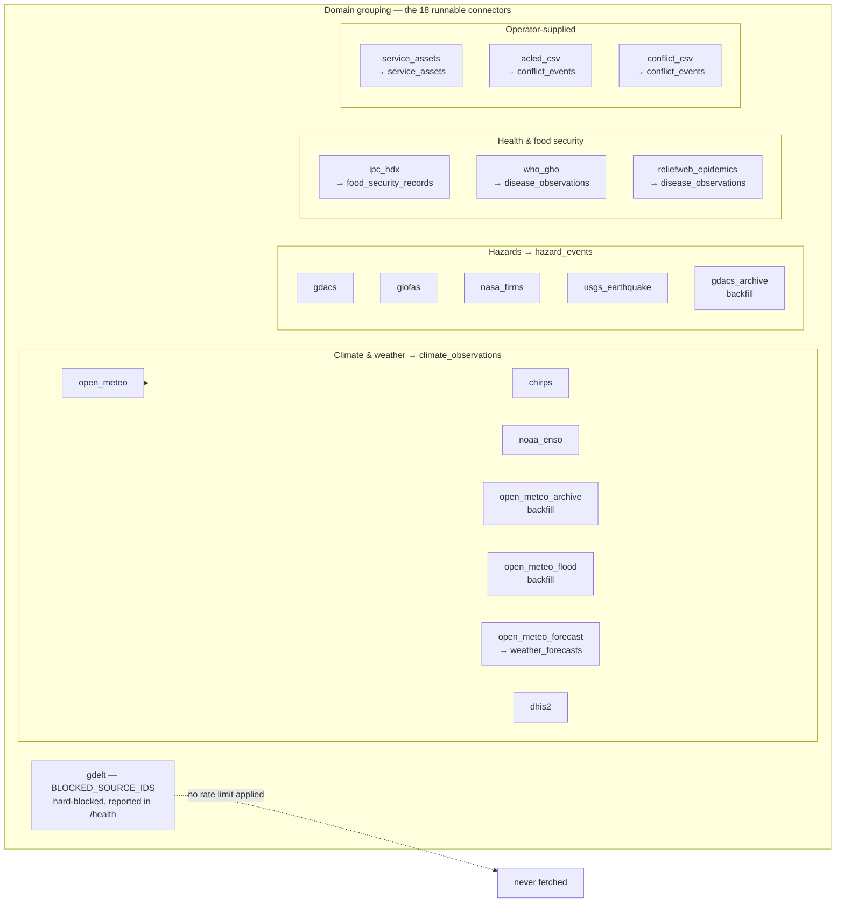
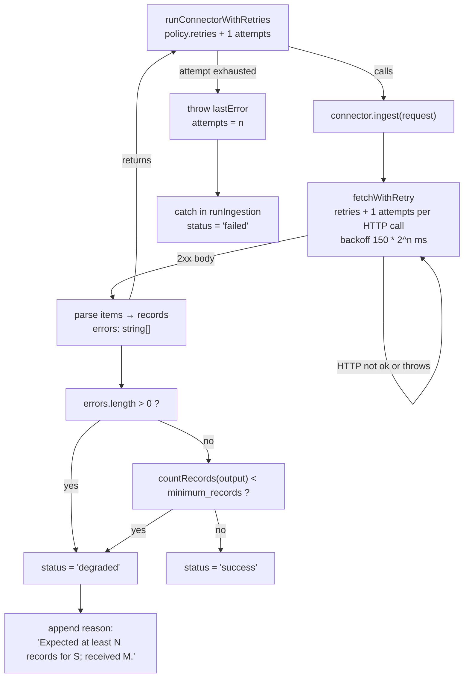
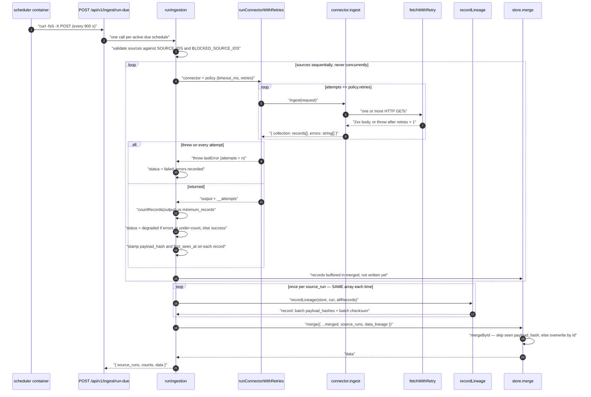

# Ingestion

How an external HTTP response becomes a row in `lite_records`, and what happens
when it does not.

The dangerous failure mode in ingestion is not a crash. It is a connector that
fetches successfully, parses nothing, and reports success — a dashboard then shows
"no flood forecast" where the truth is "we stopped receiving floods". Several of the
guards below exist only because that already happened.

## Trigger paths

Recurrence is an **in-process timer**. The periodic driver
(`createPeriodicDriver`, `src/server.js:443`) ticks every
`LINDELA_LITE_SCHEDULER_INTERVAL_SECONDS` (default 900) and runs the driver items
in order, ingestion among them. The paths below remain reachable by hand and by
any external caller, which is what makes an API key relevant to them — the driver
itself calls the functions, not the HTTP surface.

| Path | Handler | Notes |
|---|---|---|
| `POST /api/v1/ingest/run` | `src/routes/ingestion.js:119` → `runIngestion` | Body may carry `sources`, `timeout_ms`, `retries`. Defaults to `PUBLIC_INGESTION_SOURCES`. |
| `POST /api/v1/ingest/run-due` | `runDueIngestionSchedules` (`src/routes/ingestion.js:151`) | The scheduled path, and the first `DRIVER_ITEMS` entry (`src/server.js:118`), so the in-process driver runs it every `LINDELA_LITE_SCHEDULER_INTERVAL_SECONDS` (900 by default) without an HTTP hop. Only schedules with `status === 'active'` and `next_run_at <= now` run (`ingestionScheduleIsDue`, `src/ingestion.js:862`). |
| `POST /api/v1/ingest/schedules/{id}/run` | `src/routes/ingestion.js:185` | Runs one schedule immediately, ignoring `next_run_at`. |
| `POST /api/v1/service-assets` | `src/routes/operational.js:113` | **Implicit fourth path.** The body *is* the connector input; it calls `runIngestion(store, { ...body, sources: ['service_assets'] })`, so a request-body boolean gates the run, not a route check. |

`run-due` fires `runIngestion` once **per due schedule**, each with `sources: [schedule.source]`
(`src/ingestion.js:829`). Nine default schedules means nine separate single-source
`runIngestion` calls, each with its own `merged` accumulator and its own write.

The periodic driver is a `setInterval` inside the server process (`createPeriodicDriver`,
`src/server.js:443`), not a sidecar container: `docker-compose.yml` runs two services, `db`
and `app`, and the shell loop that used to call `run-due` from outside was retired when the
driver took over report schedules too.

## The connector contract

`defineConnector({ id, description, schema, defaults, ingest })` in
`src/connectors/spec.js:18`. The returned spec is frozen and validates `id`,
`description`, `schema`, `defaults`, and that `ingest` is a function.

`ingest(options)` returns `Promise<{ <collection>: Record[], errors: string[] }>`.

There are 18 connectors in `CONNECTORS` (`src/ingestion.js:44`), the map
`runIngestion` reads. `connectors.registry.json` holds 20 entries over 18
modules: `kobo` and `iot` are listed there and absent from the map, so
`getConnector` refuses them — built and tested, not registered. The registry is
what `GET /api/v1/connectors` serves, so the difference is visible over HTTP and
`test/connector-registry-parity.test.js` holds it by name.

## Sources

Sources run **sequentially** in a `for` loop (`src/ingestion.js:177`), never
concurrently. Consequences: a full default run's wall-clock is the *sum* of every
source's latency, and one slow source delays every alert downstream of it. The
`duration_ms` recorded per run is that source's own slice.

The nine sources in `PUBLIC_INGESTION_SOURCES` (`src/ingestion.js:68`) are the
default run set. The three archive backfills are deliberately excluded from it
(their `regular: false` rows start at `src/ingestion.js:113`):
`gdacs_archive` is a quarter-by-quarter crawl of 40 years, and putting it on a
recurring schedule would be abuse of a free service. They carry
`interval_minutes: 0` and `regular: false`, and `computeNextIngestionRunAt` returns
`null` for a zero interval (`src/ingestion.js:882`), so a default-seeded schedule can
never pick them up.



Marks that matter more than the grouping:

- **`glofas` is broken.** Its RSS URL serves the EFAS single-page app, not a feed.
  The connector detects this with `looksLikeFeed(text)` (`src/connectors/glofas.js:104`)
  and pushes a descriptive error rather than reporting an empty success
  (`src/connectors/glofas.js:23`).
  Every run is `degraded` with zero records. It stays in the default set.
- **`gdelt` is hard-blocked** in `BLOCKED_SOURCE_IDS` (`src/schema.js:24`);
  `getConnector` and `runIngestion` both throw on it, and `/api/v1/health` reports
  it under `exclusions` (`src/routes/liveness.js:145`). It has no connector and no code path.
- **`acled_csv` is gated on a request-body boolean**, not a verified licence
  (`src/connectors/uploads.js:35`). `acled_license_accepted: true` in the POST body
  is the entire gate; the data is user-supplied and the record carries
  `license: 'user_supplied_acled_license'`.
- **`rateLimit.perMinute` is declared and never enforced.** Every spec carries it
  (`src/connectors/glofas.js:86` and 12 others) and `connectors.registry.json`
  repeats it. Nothing reads it. There is no throttle, limiter, or token bucket
  anywhere in `src/`. It is documentation shaped like configuration.

## The two retry layers

These are independent and they multiply.

`fetchWithRetry` (`src/connectors/http.js:234`) wraps a single HTTP request:
`retries + 1` attempts, backoff `150 * 2^attempt` ms, 20 s default timeout,
`AbortSignal.timeout`.

`runConnectorWithRetries` (`src/ingestion.js:1112`) wraps the whole connector:
`policy.retries + 1` attempts, backoff `min(1000 * 2^attempt, 5000)`.

Worst case for `open_meteo` (`retries: 2`) is **9 HTTP attempts across 3 connector
attempts**. A connector that loops internally — `gdacs_archive` paginates — multiplies
that again.



Status resolution is three-valued (`src/ingestion.js:232`):

- **`failed`** — the connector threw after all retries. No records.
- **`degraded`** — it returned, but with any `errors`, **or** fewer than
  `minimum_records`. Under-count appends a human-readable reason to the error list.
- **`success`** — no errors and the record count met the floor.

`minimum_records` is `1` for every remote source and `0` for the operator-supplied
and `dhis2` ones (`SOURCE_POLICIES`, `src/ingestion.js:90`). The comment records why:
with `0`, a connector that silently parses nothing still reports success, "which is
how CHIRPS, GloFAS, and NASA FIRMS all hid broken ingestion."

## One collection list, three counters

`OUTPUT_COLLECTIONS` (`src/ingestion.js:1152`) is the single list of the nine
collections a run can accumulate, and three things read it rather than spelling
their own: the merged accumulator that `runIngestion` builds
(`src/ingestion.js:185`), `countRecords` (`src/ingestion.js:1164`) and
`countRecordsByCollection` (`src/ingestion.js:1169`). So the floor check that
compares `countRecords` against `minimum_records` sees the same set the connector
writes to.

**What this replaced.** Each of the three carried its own hand-typed list, and they
had drifted: `countRecords` summed four collections and omitted
**`food_security_records`** and **`disease_observations`**, so `ipc_hdx` and
`who_gho` counted `0` on every run, `0 < minimum_records: 1` always fired, and a
healthy run ingesting 500 IPC classifications reported `degraded` with
*"Expected at least 1 records for ipc_hdx; received 0."* — a confident, specific
and false statement. `countRecordsByCollection` had the identical omission, so
`diagnostics.records_by_collection` was wrong the same way. The list is exported
and asserted on rather than grepped, because a guard that greps source text for a
collection name passes with the bug fully present — this repository's signature
defect, and the reason the comment above the list says so.

## Lineage is per-source-run, written inside the loop

`recordLineageRow` (`src/provenance.js:239`) builds one `data_lineage` row for one
source run, over *that run's own records*, and `commitSource`
(`src/ingestion.js:619`) writes it as part of the same per-source merge as the
records, the quarantine rows and the watermark:

```js
lineage: recordLineageRow({
  sourceRun: source_runs[source_runs.length - 1],
  records: runRecords,
  provenance,
}),
```

So `record_count` and `payload_hashes` describe the run the row names, and the row
id is derived from `[source, source_run_id]` with no clock in it, so a re-run
replaces its row rather than adding a second one.

**What this replaced (ENH-15).** The loop it superseded — which this document
described as a live defect — rebuilt `allRecords` as the union of every source's
records and wrote that union once per source run, after every source had already
run. A nine-source run therefore produced nine rows whose `record_count` and
`payload_hashes` each described the whole batch, attributed to nine different
sources, and `stableId(..., now)` gave each a fresh id so the store kept all nine.
`upstream_url_or_endpoint` was a hardcoded `null` and `transform_version` a
constant `'0.1.0'` typed once and never revisited; `transformVersionFor` now
derives the version from the source of the function that did the work
(`src/provenance.js:112`), and `upstream_url_or_endpoint` carries the first
retrieval URL (`src/provenance.js:254`).

## Idempotency

Two mechanisms, both needed:

- **`canonicalHash(record)` → `record.payload_hash`**, assigned in `runIngestion` if
  the connector did not set it (`src/ingestion.js:409`). This is *content* identity:
  the same upstream record fetched twice hashes the same and is recognised as
  unchanged.
- **`stableId(...)`** in each connector gives a deterministic `id` from source and
  natural key (e.g. `stableId('hazard', ['glofas', link, title])`). This is *entity*
  identity across updates.

`mergeById` (`src/store.js:1123`) keys on `id`, and skips an incoming record whose
`payload_hash` is already in the collection — a no-op re-fetch costs no rows.
Otherwise it merges `{ ...existing, ...incoming }`, so a corrected upstream value
overwrites. Records are then sorted by `recordTimestamp`, which walks a fixed
precedence of date fields and falls back to `''`.

`first_seen_at` is stamped once, at first ingest (`src/ingestion.js:412`), and is
never refreshed on later merges.

`postgres-store.js` mirrors this without a unique constraint: the dedup is an
application-level check, a `SELECT payload_hash … WHERE collection = $1 AND
payload_hash = ANY($2::text[])` over just the batch's hashes
(`src/postgres-store.js:955`), backed by a non-unique partial index
`lite_records_collection_hash_idx ON lite_records (collection, payload_hash)
WHERE payload_hash IS NOT NULL` (`src/migrations.js:117`). The index is a lookup
structure, not a guard — two concurrent writers can each pass the check and both
insert. What the write itself relies on is `ON CONFLICT (collection, id)`
(`src/postgres-store.js:978`), which is keyed on `id`, not on the hash.

## End-to-end



Note the write boundary: `store.merge` happens **once, at the end**. A process killed
mid-run leaves no partial records from the sources that already succeeded — their
`source_runs` are lost with them.

## Idempotency of a run itself

`source_runs[].id` is `stableId('run', [source, startedAt, status, errors])`
(`src/ingestion.js:361`). It includes the wall-clock `startedAt`, so two runs of the
same source in the same millisecond with the same outcome collapse, and two runs a
second apart never collapse. Run history is append-only in practice.

## Errors and observability

Every run emits `metrics.counter('ingestion_runs_total', { source, status })` and
`metrics.histogram('ingestion_duration_ms', durationMs, { source })`
(`src/ingestion.js:509`). Note that the counter is emitted for `failed` and
`degraded` alike — there is no separate error counter.

`ingestionStatus(data)` (`src/ingestion.js:926`) derives per-source health:
`never_run` → `failed` → `stale` (older than `stale_after_minutes`) → `degraded` →
`fresh`. Staleness is checked *before* `degraded`, so a degraded run that also aged
out reports `stale` and the degradation is only visible on the run itself.

`stale_after_minutes` is set per source and is not uniform: `gdacs` 180,
`open_meteo`/`glofas` 360, `chirps`/`noaa_enso` 1440, `ipc_hdx` 2880, `who_gho`
20160 (14 days). The WHO window is long because it publishes annually — "stale" there
means something broke, not that the data is old.

## Unresolved

- `recordLineage(store, ...)` takes `store` and does not use it. Whether the intent
  was per-source records, or a store-side digest, is not recoverable from the code.
- `recordTimestamp` falls back to `''`, so records with no recognised date field sort
  to the end deterministically but silently. Whether that is intended is not stated.
- `runDueIngestionSchedules` returns an `analytics` array of full ingestion results
  that no caller in `src/` appears to consume.
